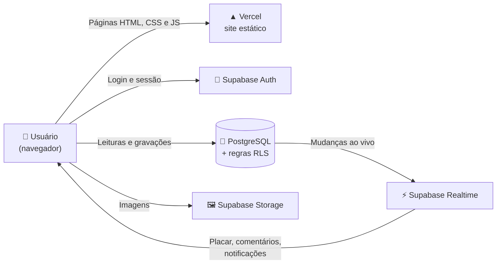

# 🏆 VersusHub

<div align="center">
  
  
  
  
</div>

<br>

**🌍 Acesso ao site:** [Clique aqui para acessar o projeto online](https://versus-hub-repository-jyb7.vercel.app/pagina_inicial/index.html)

> **A plataforma definitiva para organizar, gerenciar e vivenciar torneios de e-sports amadores e independentes.**

O **VersusHub** é uma plataforma web para criar, gerenciar e participar de torneios on-line ou presenciais. Ele foi pensado para centralizar todas as etapas de uma competição em um ambiente moderno, confiável e gratuito para eventos de e-sports.

<details>
<summary><b>📑 Sumário</b></summary>

- [O Problema](#-o-problema)
- [A Solução](#-a-solução)
- [Funcionalidades](#-funcionalidades)
- [Tecnologias Utilizadas](#-tecnologias-utilizadas)
- [Como Foi Feito](#-como-foi-feito)
- [Segurança e Privacidade](#-segurança-e-privacidade)
- [Estrutura do Projeto](#-estrutura-do-projeto)
- [Como Rodar o Projeto](#-como-rodar-o-projeto)
- [Desenvolvimento e Autoria](#-desenvolvimento-e-autoria)

</details>

---

## 🎯 O Problema

O cenário de games e e-sports cresce exponencialmente a cada ano, mas a organização de torneios independentes parou no tempo. Hoje, organizar um campeonato amador significa lidar com:
* **Improviso:** Uso de planilhas confusas, grupos lotados de mensagens e formulários soltos.
* **Caos nas Inscrições:** Inscrições desorganizadas, erros de limite de vagas e falta de controle.
* **Falta de Transparência:** Nenhuma clareza na atualização de resultados, chaves e pontuações.
* **Invisibilidade:** Pouca visibilidade para torneios locais, organizadores independentes e jogadores amadores.

## 💡 A Solução

O sistema centraliza a divulgação, as inscrições e o acompanhamento do torneio em um único lugar, trazendo ferramentas de nível profissional para o cenário amador:

* 👑 **Para Organizadores:** Fluxo simples para criar o torneio, definir regras, cadastrar partidas, atualizar pontuações em tempo real e fornecer links oficiais de transmissão.
* 🎮 **Para Jogadores:** Criação de perfis, gerenciamento de equipes (com sistema de convites e solicitações) e inscrições organizadas (individuais ou por equipe).
* 👁️ **Para Espectadores:** Páginas públicas para pesquisar torneios, acompanhar os resultados e acessar as transmissões ao vivo sem necessidade de cadastro.

---

## ✨ Funcionalidades

| Área | O que o usuário pode fazer |
|---|---|
| 🔐 **Contas** | Cadastro e login com Supabase Auth, recuperação de senha e perfil criado automaticamente no cadastro. |
| 👤 **Perfil** | Avatar, banner, biografia, jogos favoritos, plataformas e estatísticas (pontos, vitórias, títulos, taxa de vitória). Perfil público para outros jogadores. |
| 👥 **Equipes** | Criar equipe com logo, convidar jogadores, aceitar solicitações e gerenciar membros. |
| 🏆 **Torneios** | Criar torneio solo, por equipe ou misto, com regras, vagas, premiação e banner. Inscrições com aprovação do organizador. |
| ⚔️ **Chaveamento** | Criação de partidas, placares, avanço automático do vencedor e encerramento com pódio oficial (campeão +500, vice +250 pontos). |
| 🔴 **Ao Vivo** | Uma partida com link de transmissão (YouTube/Twitch) e sem vencedor coloca o torneio "Ao Vivo" automaticamente, e ele aparece na página de transmissões. |
| ⚡ **Tempo Real** | Placar, chaveamento, inscrições, comentários e notificações se atualizam sozinhos, sem recarregar a página. |
| 💬 **Comentários** | Comentários públicos em cada torneio, com moderação pelo organizador e proteção contra spam. |
| 🔔 **Notificações** | Convites, aprovações, encerramento de torneio e avisos agrupados de comentários, no estilo "fulano e mais 3 pessoas comentaram". |
| 📊 **Ranking** | Ranking global de jogadores e de equipes, com pódio, busca e pontuação consolidada dos torneios. |
| 🗂️ **Gerenciar Torneios** | Painel com "Seus torneios", "Participando" (inclusive pela equipe) e "Torneios frequentados". |

---

## 🛠️ Tecnologias Utilizadas

Este projeto foi construído utilizando uma arquitetura *Serverless*, focando em performance, baixo custo de infraestrutura e carregamento ultrarrápido.

<div align="center">

  
  
  
  
  
  

</div>

* **Front-end:** HTML5, CSS3 e JavaScript puro (Vanilla JS), garantindo leveza e validação precisa do protótipo construído no Figma.
* **Back-end & Banco de Dados:** Supabase, fornecendo um banco de dados relacional (PostgreSQL) robusto e seguro.
  * **Supabase Auth** para login e sessões.
  * **Row Level Security (RLS)** e funções PL/pgSQL para as regras de negócio que precisam de garantia no servidor.
  * **Supabase Realtime** para as atualizações ao vivo.
  * **Supabase Storage** para avatares, logos e banners.
* **Hospedagem:** Vercel (Arquitetura Serverless e Estática).
* **Controle de Versão:** Git & GitHub.

---

## 🧩 Como Foi Feito

O VersusHub não tem um servidor próprio: as páginas são arquivos estáticos publicados na Vercel, e o navegador conversa direto com o Supabase. Toda regra que não pode depender do navegador (quem pode editar o quê, pontuação, notificações) fica **dentro do banco de dados**.



**Principais decisões do projeto:**

* 🔒 **Segurança no banco, não no navegador.** Cada tabela tem regras de Row Level Security: um visitante só lê, cada usuário só altera o que é dele e só o organizador mexe nas partidas do próprio torneio. Mesmo que alguém altere o JavaScript da página, o banco recusa a operação.
* 🏁 **Pontuação feita pelo banco.** Ao encerrar um torneio, a função `vh_encerrar_torneio` confere se quem chamou é o organizador, se os participantes realmente estão no torneio e se os números fazem sentido, e só então grava os pontos de todos de uma vez. Uma marcação impede pontuar o mesmo torneio duas vezes.
* ⚡ **Tempo real em vez de consultas repetidas.** O site escuta as mudanças pelo Supabase Realtime: o servidor só envia algo quando um dado muda. As notificações usam a consulta ao banco apenas como reserva.
* 🖼️ **Imagens no Storage.** Avatares, logos e banners são comprimidos no navegador e guardados no Supabase Storage; o banco guarda só o endereço. Isso deixa as listagens leves e economiza o plano gratuito.
* 🔔 **Notificações agrupadas.** Comentários geram uma única notificação para o organizador, atualizada a cada novo comentário até ser lida, em vez de lotar a caixa de avisos.

---

## 🛡️ Segurança e Privacidade

* Senhas ficam somente no **Supabase Auth**, com hash; o banco do site não guarda senha.
* **Regras de acesso (RLS)** em todas as tabelas e no Storage.
* **Comentários:** de 1 a 500 caracteres, no máximo 5 por minuto por pessoa, e o texto é exibido como texto puro (HTML digitado não é executado).
* **Upload de imagens:** até 2 MB, somente JPEG, PNG, WebP e GIF, e cada usuário só envia para a própria pasta.
* O **ranking público** mostra nome e região, nunca o e-mail dos jogadores.

---

## 📁 Estrutura do Projeto

```text
Versus-Hub-Repository/
├── pagina_inicial/          # Página inicial, lista de torneios e o script compartilhado (menu, notificações)
├── login/ · cadastro/       # Entrar, criar conta e recuperar senha
├── perfil/                  # Perfil do usuário e perfil público
├── equipes/ · cria_equipe/  # Listagem, criação e gerenciamento de equipes
├── criar_torneio/           # Formulário de criação de torneio
├── gerenciartorneios/       # Painel "Gerenciar Torneios"
├── torneio/                 # Página do torneio: detalhes, chaveamento, inscrições e comentários
├── aovivo/                  # Página de transmissões ao vivo
├── ranking.html/.js/.css    # Ranking global de jogadores e equipes
├── feedback/ · termos/      # Feedback e Termos de Uso / Política de Privacidade
├── supabaseClient.js        # Conexão com o Supabase e funções compartilhadas
├── supabase_schema.sql      # Criação das tabelas e views do banco
├── supabase_seguranca.sql   # Regras de segurança, funções, Storage e tempo real
├── scripts/                 # Utilitários de manutenção (não são publicados no site)
└── vercel.json              # Rotas e redirecionamentos da Vercel
```

---

## 🚀 Como Rodar o Projeto

<details>
<summary><b>1. Configurar o banco no Supabase</b></summary>

<br>

1. Crie um projeto em [supabase.com](https://supabase.com).
2. No **SQL Editor**, execute o arquivo **`supabase_schema.sql`** (cria as tabelas e views).
3. Em seguida, execute o arquivo **`supabase_seguranca.sql`** (regras de segurança, funções de pontuação, Storage de imagens, comentários, notificações e tempo real). Ele pode ser executado de novo sempre que for atualizado.
4. Em **Project Settings → API**, copie a **URL do projeto** e a **chave pública** (*publishable/anon key*) e coloque-as em `supabaseClient.js`.

> ⚠️ Nunca coloque a chave `service_role` no código do site: ela ignora todas as regras de segurança.

</details>

<details>
<summary><b>2. Rodar localmente</b></summary>

<br>

O site é estático, mas os caminhos são absolutos (`/pagina_inicial/...`), então ele precisa ser servido a partir da **raiz do projeto**. Qualquer servidor estático serve, por exemplo:

```bash
npx serve .
```

ou

```bash
python -m http.server 8000
```

Depois abra `http://localhost:8000/pagina_inicial/index.html` (ou a porta indicada pelo `serve`).

</details>

<details>
<summary><b>3. Publicar na Vercel</b></summary>

<br>

1. Importe o repositório na [Vercel](https://vercel.com). Não há etapa de build.
2. O `vercel.json` já configura a página inicial e os redirecionamentos de endereços antigos.
3. Cada push na branch `main` publica o site; cada pull request ganha uma prévia própria para testes.

</details>

---

## 👥 Desenvolvimento e Autoria

Este projeto faz parte do TCC (Trabalho de Conclusão de Curso) acadêmico do curso de Técnico em Desenvolvimento de Sistemas do SENAI Dendezeiros.

**Liderança Técnica e Desenvolvimento:**
Toda a arquitetura do VersusHub, desde a construção da interface (Vanilla JS/HTML/CSS) até a modelagem do banco de dados relacional (PostgreSQL/Supabase) e a infraestrutura de deploy (Vercel), foi idealizada, codificada e mantida por **[Gabriel Costa de Oliveira](https://github.com/gabriel-c-oliveira946)**.

**Equipe do Projeto:** [Gabriel Costa de Oliveira](https://github.com/gabriel-c-oliveira946), [Caíque Brandão](https://github.com/caique-brandao09), João Pedro, João Vitor Nascimento Santos e Lucas Vinicius Pereira Rodrigues.

---
<div align="center">
  <i>"Elevando o cenário amador de e-sports para o próximo nível."</i>
</div>
